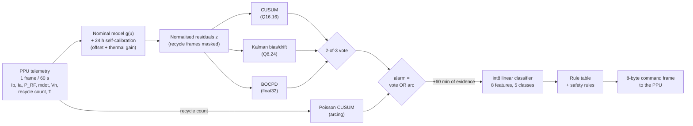

# Onboard Autonomous Fault Detection, Isolation, and Recovery for CubeSat-Class Ion Thruster Health Monitoring

**Siddharth Paul, Hardik Gangrade**, Chandigarh University

Code and results for the full paper submitted to the **6th National Aerospace Propulsion Conference (NAPC 2027)**, IIT Hyderabad, 4–6 January 2027.

---

## Summary

Small gridded ion thrusters on CubeSats wear out slowly. The accelerator grid erodes, the neutraliser cathode ages, high-voltage arcing becomes more frequent, the propellant feed weakens and the RF circuit loses efficiency. Each of these faults shows up in the power-processing-unit (PPU) telemetry hours or days before it does real harm. Today that telemetry is usually checked on the ground. A CubeSat is in contact only a few times a day, so a fault is often seen at the next pass, analysed, and fixed one or more passes later. This repository contains an onboard alternative: a fault detection, isolation and recovery (FDIR) pipeline small enough to run on an ARM Cortex-M4 flight computer. It compares each 60 s telemetry frame with a self-calibrated nominal model and detects drifts with three statistical detectors that vote. It then names the fault with a tiny int8 classifier and sends a safety-checked corrective command to the PPU, with no ground contact needed.

## Scope

**All results in this repository come from a physics-informed simulation, not from flight or laboratory data.** The thruster model is a reduced-order model of a 2.5 cm iodine RF gridded ion thruster near a BIT-3-class operating point. Its parameter values and all fault magnitudes, growth rates and onset times are **assumptions** chosen to be physically plausible. They are not vendor data. The results show how the pipeline behaves on telemetry with these assumed characteristics. They do not predict the behaviour of any particular thruster.

The ARM Cortex-M4 numbers are compiler size reports and **instruction counts from an emulator (Unicorn)**. They are not cycle-accurate timing or power measurements on real hardware.

The following are **future work** and are not part of this repository:

- validation on real thruster telemetry (ground test or flight);
- execution-time measurement on target hardware (e.g. the DWT cycle counter) and measurement of supply current and power during `fdir_step`.

---

## Table of contents

1. [Architecture](#architecture)
2. [Repository map](#repository-map)
3. [Physics model](#physics-model)
4. [Key results](#key-results)
   - [Detection versus fixed limit checks, and ablation](#41-detection-versus-fixed-limit-checks-and-ablation)
   - [False alarms](#42-false-alarms)
   - [Isolation accuracy and classifier weights](#43-isolation-accuracy-and-classifier-weights)
   - [Closed-loop recovery](#44-closed-loop-recovery)
   - [Ground-in-the-loop versus onboard](#45-ground-in-the-loop-versus-onboard)
   - [Robustness](#46-robustness)
   - [Fixed-point and C-versus-Python equivalence](#47-fixed-point-and-c-versus-python-equivalence)
   - [ARM Cortex-M4 footprint](#48-arm-cortex-m4-footprint)
   - [Command frame format and safety rules](#49-command-frame-format-and-safety-rules)
5. [Reproduction on Windows with WSL2 Ubuntu](#reproduction-on-windows-with-wsl2-ubuntu)
6. [Viewing the telemetry](#viewing-the-telemetry)
7. [Running the onboard C demo](#running-the-onboard-c-demo)
8. [Reproducibility](#reproducibility)
9. [Limitations and future work](#limitations-and-future-work)
10. [Citation](#citation)
11. [Key references](#key-references)

---

## Architecture



| Block | What it does |
|---|---|
| **PPU telemetry** | One averaged frame every 60 s: beam current `Ib` [mA], accelerator-grid current `Ia` [mA], RF forward power `P_RF` [W], mass flow `mdot` [µg/s], neutraliser coupling voltage `Vn` [V], number of high-voltage recycles (arcs) in the minute, and module temperature `T` [°C]. |
| **Nominal model + 24 h self-calibration** | A small analytic model `g(u)` predicts each channel from the set points and temperature. Its built-in thermal sensitivities are deliberately about 10 % wrong. During the first 24 h (1440 frames) the onboard code fits a per-channel offset and thermal gain by least squares and estimates the residual standard deviation. |
| **Residuals** | `z = (y − g − offset − gain·ΔT) / σ` for each of the 5 analog channels. Frames that contain a recycle are set to zero, so arc blanking does not look like a drift. |
| **CUSUM** | Two-sided cumulative sum per channel (slack k = 0.5). It is fast for step-like and ramp shifts. Implemented in Q16.16 integer arithmetic. |
| **Kalman bias/drift** | A two-state (bias, drift) steady-state Kalman filter per channel. The gain is computed offline. The test statistic is \|bias\|/σ_bias. Implemented in Q8.24 integer arithmetic. |
| **BOCPD** | Bayesian online change-point detection (Adams & MacKay) truncated to 64 run-length hypotheses. It alarms when P(change in the last 63 samples) exceeds 0.9999 for 15 consecutive frames. Runs in float32. |
| **2-of-3 vote** | Each detector latches its first threshold crossing. The fused alarm fires when any two of the three have latched. |
| **Poisson CUSUM** | Log-likelihood-ratio CUSUM on the recycle count (healthy rate λ0 = 0.001/min versus 10·λ0). It is the only detector that sees arcing, because recycle frames are masked out of `z`. Its alarm bypasses the vote. |
| **int8 classifier** | 60 min after the alarm, 8 features (5 Kalman biases, arc score, `Vn` noise level, total drift) are standardised, quantised to int8 and passed through a 8×5 int8 linear layer. The arg-max picks one of GRID, CATH, ARC, FEED or RF. |
| **Rule table + safety rules** | Maps the class to one corrective action (table in [Physics model](#physics-model)). Separate safety rules allow at most one action per 6 h and at most 3 per fault class (after that, safe mode and wait for ground), and they enforce PPU set-point limits. |
| **8-byte command** | Each action is encoded as one or two fixed 8-byte frames with a sync word, sequence counter, opcode, argument and CRC-16 ([format](#49-command-frame-format-and-safety-rules)). |

`fig1_architecture.png` shows the same pipeline as a paper figure.

---

## Repository map

### Python (top level)

| File | Purpose |
|---|---|
| `thruster_sim.py` | Reduced-order telemetry simulator: operating point, thermal input, five fault models, closed-loop recovery actions, and the "onboard" nominal model `g(u)` (with deliberately mismatched sensitivities). |
| `fdir.py` | Reference FDIR pipeline, vectorised over Monte-Carlo runs: self-calibrated residuals, CUSUM, Kalman bias/drift, truncated BOCPD, Poisson CUSUM, first-crossing alarms, isolation features, logistic-regression training, int8 quantisation, and Q16.16 / Q8.24 fixed-point versions of CUSUM and the Kalman filter. |
| `run_experiments.py` | Main experiment. Generates 400 training runs (seed 1) and 600 test runs (seed 2) of 300 h each. Sets thresholds from healthy training runs, measures detection and false alarms, trains and quantises the classifier, re-simulates every fault run with the chosen action applied, and checks fixed point against float. Writes `results.json` and `examples.npy`. |
| `sensitivity.py` | Robustness study: weaker faults (severity × 0.1, 0.25, 0.5) and thermal model mismatch (true sensitivities × 1.5, × 2.0). Writes `sensitivity.json`. |
| `figures.py` | Draws `fig1_architecture.png` … `fig5_closedloop.png` from `results.json` and `examples.npy`. |
| `ground_vs_onboard.py` | Compares no action, onboard FDIR, and three ground-in-the-loop contact scenarios on the same 500 test fault runs. The argument `fast` makes faults grow 10× faster. Writes `ground_vs_onboard.json` / `ground_vs_onboard_fast.json`. |
| `extra_analyses.py` | Fixed limit-check baseline, detector ablation and classifier weights. Writes `extra_analyses.json`. |
| `extra_analyses2.py` | Leave-one-out ablation and dataset statistics. Writes `extra_analyses2.json`. |

### C and helpers (`c/`)

| File | Purpose |
|---|---|
| `fdir.h`, `fdir.c` | Onboard FDIR in C99 for a Cortex-M4F. `fdir_init()` sets up the state. `fdir_step()` is called once per 60 s frame and returns an action code (normally `ACT_NONE`). All state (`fdir_t`, about 3 kB) is supplied by the caller. The code has no heap and no static data. |
| `fdir_params.h` | **Auto-generated.** Model constants, thresholds in fixed-point units, Kalman gains, BOCPD lookup tables and the int8 classifier weights. |
| `gen_params.py` | Generates `fdir_params.h` from `../results.json`. Needs Python ≥ 3.12 (see [step 6](#step-6--onboard-c-pipeline-on-the-host-logs-05-and-06)). |
| `fdir_cmd.h`, `fdir_cmd.c` | OBC → PPU command interface: frame format, opcodes, safety limits, CRC-16/CCITT-FALSE, and `cmd_encode()`, which turns an action into frames or refuses it. |
| `cmd_test.c` | Host program that prints the frames produced for each action and exercises the safety rules. |
| `host_test.c` | Host equivalence test for the detectors alone. Reads `z.bin` / `narc.bin` and writes debug taps to `c_out.bin`. Those input files are not in the repository, and the script that produced them is not either. |
| `host_e2e.c` | Host end-to-end demo: raw telemetry frames from `frames.bin` → `fdir_step()`. Prints 7 numbers (see [below](#running-the-onboard-c-demo)). |
| `bench.c` | Bare-metal harness (reset handler, FPU enable, vector table) for running `fdir_step()` under emulation. |
| `m4.ld` | Linker script: 1 MB flash at 0x08000000, 128 kB RAM at 0x20000000. |
| `emu_count.py` | Runs `bench.elf` in the Unicorn Cortex-M emulator on a simulated GRID-erosion trace. Counts executed instructions for selected frames and the peak stack depth. Writes `emu_counts.json`. |
| `emu_breakdown.py` | Splits the instruction count of one steady-state frame by function. Writes `emu_breakdown.json`. |
| `make_frames.py` | Simulates one 300 h run for a given fault (seed 1). Writes `frames.bin` (input to `host_e2e`) and `telemetry_<FAULT>.csv`. |

Generated files in `c/`: `*.o`, `*.su` (GCC stack-usage reports), `bench.elf`, `host_e2e`, `cmd_test` (host binaries), `frames.bin`, `e2e_out.bin` (per-frame debug taps from `host_e2e`), `telemetry_*.csv`, `emu_counts.json` and `emu_breakdown.json`. `e2e_compare.json` holds a 20-run comparison of C and Python alarm times (see [4.7](#47-fixed-point-and-c-versus-python-equivalence)). The script that produced it is not in the repository.

### Results, figures and other files

| Path | Content |
|---|---|
| `results.json` | Thresholds, detection statistics per fault and detector (including every individual delay), false alarms, confusion matrices, recovery metrics, fixed-point checks, classifier weights, configuration. |
| `examples.npy` | One example test run per class (residuals, detector traces, alarm time), used by `figures.py`. About 17 MB. |
| `sensitivity.json` | Output of `sensitivity.py`. |
| `sensitivity_noreg.json` | The same structure as `sensitivity.json`, but the mismatch results are much worse. It appears to be the same study run without the thermal-gain term in the self-calibration (`Tp=None` in `fdir.normalised_residuals`). **No script in the repository produces this file**, so treat this interpretation as unconfirmed. |
| `ground_vs_onboard.json`, `ground_vs_onboard_fast.json` | Output of `ground_vs_onboard.py` (normal and 10× faster faults). |
| `extra_analyses.json`, `extra_analyses2.json` | Outputs of the two extra-analysis scripts. |
| `fig1_architecture.png` … `fig5_closedloop.png` | Paper figures: architecture, example residuals, detection-delay box plots, int8 confusion matrix, closed-loop examples. |
| `original/` | `results.json`, `sensitivity.json`, `sensitivity_noreg.json` from the first machine, kept for the reproducibility comparison. |
| `logs/` | Console output of every step of the reproduction, `00` to `15` (see [Reproduction](#reproduction-on-windows-with-wsl2-ubuntu)). |
| `README.txt` | Older short instructions. Superseded by this file. |
| `__pycache__/` | Python bytecode cache. It can be deleted. |

---

## Physics model

### Telemetry channels

| # | Channel | Symbol | Unit | Healthy mean ± std (test set) | Noise σ (assumed) |
|---|---|---|---|---|---|
| 0 | Beam (screen-supply) current | `Ib` | mA | 15.000 ± 0.030 | 0.03 |
| 1 | Accelerator-grid impingement current | `Ia` | mA | 0.090 ± 0.006 | 0.004 |
| 2 | RF forward power | `P_RF` | W | 35.108 ± 0.555 | 0.25 |
| 3 | Propellant mass flow | `mdot` | µg/s | 30.000 ± 0.758 | 0.30 |
| 4 | Neutraliser coupling voltage | `Vn` | V | 18.000 ± 0.417 | 0.30 |
| 5 | Recycle (arc) events per minute | `n_rec` | count | 62.2 per 1000 h | – |
| 6 | Propulsion-module temperature (input) | `T` | °C | 20.0 ± 5.6 (9.4 to 30.6) | 0.2 |

Healthy statistics are from `extra_analyses2.json` and exclude recycle frames. The spread of `P_RF`, `mdot` and `Vn` is mostly the orbital temperature swing, not noise.

### Operating point (all assumed unless noted)

| Quantity | Value | Note |
|---|---|---|
| Beam current set point `Ib,set` | 15 mA | within the BIT-3 datasheet range 9–17 mA |
| Screen voltage `Vs` | 1500 V | assumed |
| Accelerator voltage `Va` | −200 V | assumed |
| Main flow `mdot_set` | 30 µg/s | assumed |
| Propellant | iodine, I⁺, M = 126.904 u | physical constant |
| Asymptotic beam-ion cost `ε∞` | 1500 W/A | assumed |
| Primary-utilisation factor `C0` | 3.0 | assumed |
| `Ia/Ib` at nominal utilisation `χ0` | 0.006 | assumed |
| Nominal `Vn0` | 18 V | assumed |
| Healthy recycle rate `λ0` | 0.001 /min | assumed |
| Orbit period | 95 min | assumed |
| Derived: utilisation `η_m0` | 0.658 | from the above |
| Derived: nominal thrust | 0.942 mN | from the above |

### Main equations (`thruster_sim.py`)

Temperature (exogenous input), with A ∈ [6, 10] °C and a random phase φ for each run:

```
T(t) = 20 + A sin(2π t / 95 min + φ) + 0.2·N(0,1)          ΔT = T − 20
```

Propellant flow and mass utilisation (k = 1.315 µg/s per mA of I⁺):

```
mdot  = mdot_set · throttle · (1 + a_T ΔT) · (1 − f_feed)
η_m   = I_ion · k / mdot
```

RF power with a Brophy-type beam-ion production cost (Goebel & Katz, ch. 4 form):

```
ε_B(η_m) = ε∞ / (1 − exp(−C0' (1 − η_m)))          C0' = C0 (1 − 0.25 e)
P_RF     = I_ion · ε_B(η_m) / ((1 − b_T ΔT)(1 − f_RF))
```

Accelerator-grid current (charge-exchange ions scale with the neutral fraction, and erosion `e` increases impingement):

```
I_a = I_ion · χ0 · (1 − η_m)/(1 − η_m0) · (1 + 0.6 e)  +  0.02 · n_rec
```

Electron backstreaming. When grid erosion `e` exceeds the margin set by `Va` (0.70 nominally, 0.85 after a −25 V correction), electrons flow back into the discharge. The beam-current loop holds the *measured* `Ib`, so the real ion current, and therefore the thrust, falls without any visible change in `Ib`:

```
I_ebs = 3 mA · max(e − margin, 0)
I_ion = Ib,set · throttle − I_ebs
Thrust = I_ion · sqrt(2 M Vs / q)
```

Neutraliser and arcing:

```
Vn    = Vn0 + c_T ΔT + ΔVn                  (a worn cathode also makes Vn noisier)
n_rec ~ Poisson(λ(t) · 1 min)                (each recycle blanks Ib and P_RF for ~3 s of the 60 s average)
```

True thermal sensitivities are `a_T, b_T, c_T` = 0.0040, 0.0020, 0.050. The onboard model uses 0.0036, 0.0018, 0.045 and `C0` × 1.03, a built-in mismatch of about 10 % that the self-calibration must absorb.

### Fault classes

Faults start at a random time between 50 h and 150 h. They grow as a ramp `clip((t − t0)/τ, 0, 1)`, raised to the power 1.5 for grid erosion. Each run lasts 300 h.

| Class | Mechanism | Assumed magnitude and growth | Telemetry signature | Corrective action (rule table) |
|---|---|---|---|---|
| **GRID** | Accelerator-grid aperture erosion | erosion index e → 0.8–1.2; τ = 100–300 h | `Ia` rises; `P_RF` rises (more neutral loss); electron backstreaming once e > 0.70 (thrust lost, `Ib` unchanged) | 1: `Va` −25 V (backstreaming margin 0.70 → 0.85); throttle instead if `Va` is already at −300 V |
| **CATH** | Neutraliser/cathode wear | `Vn` rise of 2–5 V; τ = 50–200 h | `Vn` rises and becomes noisier | 2: switch to the redundant neutraliser (sim: ΔVn → 0) |
| **ARC** | Increasing high-voltage breakdown | recycle rate 0.001 → 0.02–0.06 /min; τ = 10–50 h | more recycles, `Ia` spikes, `Ib` and `P_RF` blanking | 3: throttle −10 % + HV conditioning (sim: excess arc rate cut to 30 %) |
| **FEED** | Feed-system degradation (iodine sublimator) | flow loss 8–20 %; τ = 20–150 h | `mdot` falls; `η_m` rises, changing `P_RF` and `Ia` | 4: sublimator heater set-point correction (sim: recovers 80 % of the deficit) |
| **RF** | RF-circuit efficiency loss | power loss 8–20 %; τ = 20–150 h | `P_RF` rises at constant `Ib` | 5: throttle −10 % to stay inside the PPU power envelope |

Every number in this table is an assumption. The effect of each recovery action in the simulator (e.g. "recovers 80 %", "cut to 30 %") is also an assumption.

---

## Key results

Unless stated otherwise: 600 test runs (100 healthy plus 100 per fault class), 300 h each, seed 2. Detection thresholds are set from the 100 healthy training runs (seed 1) as 1.10 × the largest healthy value; for BOCPD the threshold is min(1.05 × max, 0.9999). The resulting thresholds are CUSUM 16.15, Kalman 4.80 σ, BOCPD 0.9999 (15-frame persistence), Poisson CUSUM 9.75. "Delay" means the time from fault onset to alarm.

### 4.1 Detection versus fixed limit checks, and ablation

Median detection delay in hours, with the interquartile range for the main detectors (`results.json`). All entries detect 99–100 % of runs.

| Detector | GRID | CATH | ARC | FEED | RF |
|---|---|---|---|---|---|
| CUSUM only (+ arc) | 18.6 (14.6–22.1) | 6.5 (4.9–8.8) | 11.6¹ | 2.7 (2.1–4.0) | 3.0 (2.3–4.3) |
| Kalman only (+ arc) | 15.0 (11.9–17.8) | 5.5 (4.6–7.0) | 11.6¹ | 3.0 (2.4–3.9) | 3.2 (2.5–4.1) |
| BOCPD only (+ arc) | 92.7 (67.6–113.0) | 59.7 (44.6–81.0) | 11.6¹ | 13.9 (9.8–20.4) | 34.1 (21.7–45.3) |
| **2-of-3 vote + arc (ours)** | **18.6 (14.7–22.0)** | **6.7 (5.0–8.8)** | **11.6 (8.9–14.3)** | **3.0 (2.4–4.2)** | **3.2 (2.6–4.4)** |

¹ The CUSUM, Kalman and BOCPD detectors never detect ARC on their own (0 %), because recycle frames are masked. The ARC numbers come from the Poisson CUSUM.

**Baseline: fixed limit checks** (what most satellites do today; `extra_analyses.json`). Each raw channel has upper and lower limits set as tight as possible from the healthy training runs (range ± 10 %), with 3-frame persistence. A second limit allows at most 8 recycles per 24 h.

| Method | GRID | CATH | ARC | FEED | RF | False alarms |
|---|---|---|---|---|---|---|
| Fixed limit checks | 100 % / 92.2 h | 100 % / 60.2 h | 100 % / 13.6 h | 100 % / 19.7 h | 100 % / 25.8 h | 0 |
| 2-of-3 vote + arc (ours) | 100 % / 18.6 h | 100 % / 6.7 h | 100 % / 11.6 h | 100 % / 3.0 h | 100 % / 3.2 h | 0 |

**Ablation** (`extra_analyses.json`, `extra_analyses2.json`; detection rate / median delay):

| Variant | GRID | CATH | ARC | FEED | RF | False alarms |
|---|---|---|---|---|---|---|
| Full system (2-of-3 + arc) | 100 % / 18.6 h | 100 % / 6.7 h | 100 % / 11.6 h | 100 % / 3.0 h | 100 % / 3.2 h | 0 |
| Without CUSUM (Kalman AND BOCPD) | 100 % / 92.7 h | 100 % / 59.7 h | 100 % / 11.6 h | 100 % / 13.9 h | 100 % / 34.1 h | 0 |
| Without Kalman (CUSUM AND BOCPD) | 100 % / 92.7 h | 100 % / 59.7 h | 100 % / 11.6 h | 100 % / 13.9 h | 100 % / 34.1 h | 0 |
| Without BOCPD (CUSUM AND Kalman) | 100 % / 18.6 h | 100 % / 6.7 h | 100 % / 11.6 h | 100 % / 3.0 h | 100 % / 3.2 h | 0 |
| Without arc detector | 100 % / 18.6 h | 100 % / 6.7 h | 0 % / – | 100 % / 3.0 h | 100 % / 3.2 h | 0 |
| Without vote (any one fires) | 99 % / 15.0 h | 100 % / 5.4 h | 99 % / 11.6 h | 100 % / 2.6 h | 100 % / 3.0 h | 2 |

**What this means.** In this simulation the fused detector finds slow faults 5 to 9 times earlier than tuned limit checks (GRID 18.6 h versus 92.2 h; FEED 3.0 h versus 19.7 h), with no extra false alarms. For ARC the gain is small (11.6 h versus 13.6 h), because counting recycles is already a good test. **BOCPD was redundant in these tests.** Removing it changes no result, because CUSUM and Kalman always agree first and BOCPD alone is 4 to 10 times slower. Its intended role is as a third, independent opinion that stops one misbehaving detector from causing an alarm, but these tests did not need it. Dropping the vote gives alarms 0.2 to 3.6 h earlier, at the cost of 2 false alarms (both from CUSUM). The arc detector is essential for ARC.

### 4.2 False alarms

Healthy exposure is all post-calibration time before fault onset (or before the alarm) in all 600 test runs: about 65,900 h.

| Detector | False alarms | Healthy hours | Per 1000 h |
|---|---|---|---|
| CUSUM | 2 | 65,783 | 0.030 |
| Kalman | 0 | 65,889 | 0 |
| BOCPD | 0 | 65,889 | 0 |
| Any of 3 (OR) | 2 | 65,783 | 0.030 |
| **2-of-3 vote** | **0** | **65,889** | **0** |
| Fixed limit checks | 0 | 65,889 | 0 |

**What this means.** The fused alarm produced no false alarms in about 65,900 simulated healthy hours (about 7.5 years of operation). Zero observed events does not mean a zero rate. By the usual "rule of three" (our calculation, not in the result files), the 95 % upper bound is about 3 / 65,889 h ≈ 0.05 per 1000 h. Both CUSUM false alarms happened in fault runs before onset (one GRID run, one ARC run). The thresholds come from the same simulator, so this rate holds only as far as the simulator's noise model is right.

### 4.3 Isolation accuracy and classifier weights

The classifier is a multinomial logistic regression on 8 features, trained on the training-set alarms and evaluated on the 500 detected test fault runs, 60 min after each alarm.

| Model | Accuracy (n = 500) |
|---|---|
| float64 | 99.4 % |
| int8 weights and inputs | 99.4 % (identical decisions to float on 100 % of runs) |
| int8, with fixed-point CUSUM/Kalman feeding it | 99.4 % |

Confusion matrix (int8; rows = true, columns = isolated):

| | GRID | CATH | ARC | FEED | RF |
|---|---|---|---|---|---|
| **GRID** | 98 | 0 | 0 | 0 | 2 |
| **CATH** | 0 | 100 | 0 | 0 | 0 |
| **ARC** | 0 | 0 | 100 | 0 | 0 |
| **FEED** | 0 | 0 | 0 | 99 | 1 |
| **RF** | 0 | 0 | 0 | 0 | 100 |

Learned float weights on standardised features (positive = pushes towards that class; `extra_analyses.json`):

| Feature | GRID | CATH | ARC | FEED | RF |
|---|---|---|---|---|---|
| bias `Ib` | 0.11 | −0.05 | −0.05 | −0.12 | 0.11 |
| bias `Ia` | **3.65** | −0.09 | −0.28 | −1.74 | −1.53 |
| bias `P_RF` | 0.15 | −1.45 | −1.08 | −0.07 | **2.46** |
| bias `mdot` | 0.55 | 0.33 | 0.19 | **−2.78** | 1.70 |
| bias `Vn` | −0.30 | **2.27** | −0.65 | −0.84 | −0.47 |
| arc score | −0.07 | −0.47 | **1.82** | −0.75 | −0.53 |
| `Vn` noise | 0.37 | 0.27 | −0.20 | −0.37 | −0.08 |
| total drift | 1.13 | 0.05 | −1.23 | 0.53 | −0.48 |

**What this means.** Each fault is recognised mainly by the channel the physics says it should move: `Ia` for grid erosion, `Vn` for the cathode, the recycle count for arcing, falling `mdot` for feed, rising `P_RF` for RF. This makes the classifier easy to check by hand. Quantising to int8 changed no decisions. The only errors are GRID and FEED runs labelled RF; both of those faults also raise `P_RF`. Accuracy this high is expected when train and test come from the same simulator with well-separated assumed signatures. It should not be read as an expected flight accuracy.

### 4.4 Closed-loop recovery

Every test fault run is simulated again with the int8 classifier's action applied at its isolation time, using identical noise (`results.json`, `recovery`).

| Fault | Metric (final 10 h of the run, unless stated) | No action | With FDIR |
|---|---|---|---|
| GRID | runs with electron backstreaming | 67 % | 49 % |
| CATH | mean `Vn` rise | 3.43 V | 0.00 V |
| ARC | recycles per 24 h after the action | 57.2 | 18.1 |
| FEED | mean flow deficit | 14.4 % | 3.0 % |
| RF | runs above the 40 W RF-power envelope | 58 % | 0 % |

**What this means.** For CATH, FEED and RF a single action largely removes the problem. **For grid erosion a single `Va` correction only delays backstreaming:** erosion keeps growing and in about half the runs it passes the new margin before the run ends. Repeated corrections are possible within the safety limits (up to −300 V and 3 actions per class), after which the system throttles or hands over to the ground. `fig5_closedloop.png` shows one GRID and one FEED example.

### 4.5 Ground-in-the-loop versus onboard

Ground scenarios (`ground_vs_onboard.py`) are deliberately generous to the ground. The ground runs the same detectors on the full telemetry, and operators are always right. But an alarm becomes visible only at the next pass, operators then need D hours, and the command goes up at the first pass after that. The pass phase is random for each run. Onboard acts 60 min after its own alarm, using the int8 classifier's decision.

| Scenario | Pass interval | Analysis delay | Passes needed | Operator hours per fault |
|---|---|---|---|---|
| Onboard | – | – | 0 | 0 |
| Ground fast | 6 h | 2 h | 2 | 2 |
| Ground typical | 12 h | 8 h | 2 | 8 |
| Ground slow | 24 h | 24 h | 2 | 24 |

**Time from fault onset to corrective command** (median h; the 90th percentile is in the JSON):

| Fault | Onboard | Ground fast | Ground typical | Ground slow |
|---|---|---|---|---|
| GRID | 19.6 | 27.6 | 35.7 | 55.8 |
| CATH | 7.7 | 16.2 | 25.0 | 44.6 |
| ARC | 12.6 | 20.7 | 30.6 | 49.1 |
| FEED | 4.0 | 12.3 | 20.8 | 38.9 |
| RF | 4.2 | 12.5 | 21.1 | 41.2 |

**Damage after onset** (mean per run, lower is better):

| Fault | Metric | No action | Onboard | Ground fast | Ground typical | Ground slow |
|---|---|---|---|---|---|---|
| GRID | hours with electron backstreaming | 44.8 | 32.0 | 32.0 | 32.0 | 32.0 |
| CATH | hours with `Vn` > 1 V above nominal | 161.0 | 0.0 | 0.0 | 0.8 | 10.7 |
| ARC | recycles after onset | 452.0 | 148.1 | 155.9 | 167.5 | 196.9 |
| FEED | hours with flow deficit > 5 % | 169.2 | 6.5 | 4.7 | 6.6 | 17.0 |
| RF | hours above 40 W RF power | 82.2 | 0.0 | 0.0 | 0.1 | 1.9 |

**Total impulse lost after onset** (mean N·s per run; nominal thrust 0.942 mN). This counts thrust lost to backstreaming and to throttling. Thrust lost during recycle blanking is not included.

| Fault | No action | Onboard | Ground fast | Ground typical | Ground slow |
|---|---|---|---|---|---|
| GRID | 7.9 | 5.0 | 3.9 | 3.9 | 3.9 |
| CATH | 0.0 | 0.0 | 0.0 | 0.0 | 0.0 |
| ARC | 0.0 | 63.2 | 60.4 | 57.3 | 51.1 |
| FEED | 0.0 | 0.8 | 0.0 | 0.0 | 0.0 |
| RF | 0.0 | 66.1 | 63.4 | 60.3 | 53.8 |

Onboard actions were correct in 98 % (GRID), 100 % (CATH), 100 % (ARC), 99 % (FEED) and 100 % (RF) of runs.

**Faults that grow 10× faster** (`ground_vs_onboard_fast.json`; τ × 0.1), damage after onset:

| Fault | Onset → command, onboard / ground fast / typical / slow (h) | Damage: no action / onboard / ground fast / typical / slow |
|---|---|---|
| GRID | 3.9 / 12.1 / 21.3 / 38.0 | 182.0 / 150.6 / 150.8 / 152.4 / 155.5 |
| CATH | 2.6 / 10.6 / 19.7 / 41.1 | 196.3 / 0.0 / 6.8 / 15.9 / 37.2 |
| ARC | 4.3 / 12.7 / 21.5 / 40.0 | 485.9 / 158.4 / 170.9 / 186.6 / 217.8 |
| FEED | 1.8 / 9.8 / 18.6 / 38.7 | 195.5 / 5.0 / 11.7 / 20.5 / 39.7 |
| RF | 1.9 / 10.1 / 19.9 / 37.1 | 120.1 / 0.0 / 2.3 / 7.9 / 18.8 |

**What this means.** Onboard FDIR issues the corrective command 8 to 37 h sooner than the ground scenarios, and needs no passes or operator time. With the slow-growing faults of the main study, a fast ground team gets close to the same damage, because the faults grow over days. The onboard advantage becomes clear when faults grow over hours (fast variant) or ground response is slow. Results are not uniformly in favour of onboard:

- **Onboard action costs some thrust.** Throttling for ARC and RF loses 63–66 N·s per run on average. The ground scenarios lose less only because they throttle later, while the fault does more damage.
- For FEED, ground fast is slightly better (4.7 h versus 6.5 h). For GRID, onboard loses more impulse (5.0 versus 3.9 N·s). One likely cause is the 1 FEED and 2 GRID runs that the onboard classifier labelled RF (so they were throttled), whereas the ground is assumed always right. We have not verified this run by run.
- For GRID, all scenarios give the same 32.0 h of backstreaming, because a single `Va` correction only delays backstreaming (see 4.4).

### 4.6 Robustness

**Weaker faults.** All fault severities are scaled down (for ARC, the excess recycle rate is scaled). There are 50 runs per class; thresholds are unchanged (`sensitivity.json`). Each cell gives the 2-of-3 vote detection rate / median delay, with the OR-fusion delay in brackets.

| Severity | GRID | CATH | ARC | FEED | RF | Vote false alarms |
|---|---|---|---|---|---|---|
| × 1.0 (main study) | 100 % / 18.6 h | 100 % / 6.7 h | 100 % / 11.6 h | 100 % / 3.0 h | 100 % / 3.2 h | 0 |
| × 0.5 | 100 % / 29.0 h (20.8) | 100 % / 12.8 h (9.7) | 100 % / 16.1 h (16.1) | 100 % / 4.8 h (4.5; OR 98 %) | 100 % / 5.1 h (4.6) | 0 |
| × 0.25 | 100 % / 40.8 h (31.4) | 100 % / 19.8 h (13.3) | 100 % / 28.8 h (28.8) | 100 % / 8.6 h (6.3) | 100 % / 9.5 h (7.9) | 0 |
| × 0.1 | 100 % / 69.1 h (55.3) | 100 % / 45.7 h (31.7) | 90 % / 46.3 h (46.3) | 100 % / 21.4 h (13.9) | 100 % / 22.7 h (14.8) | 0 |

**Thermal model mismatch.** The true thermal sensitivities are set to 1.5× and 2× the onboard model's values (0.0054/0.0027/0.0675 and 0.0072/0.0036/0.090, versus 0.0036/0.0018/0.045 in the model), compared with 1.11× in the main study. 100 healthy runs, about 27,600 healthy hours each.

| True sensitivities | CUSUM FA | Kalman FA | BOCPD FA | **Vote FA** |
|---|---|---|---|---|
| × 1.5 model value, with self-calibrated thermal gain (`sensitivity.json`) | 1 | 0 | 0 | **0** |
| × 2.0 model value, with self-calibrated thermal gain | 6 | 0 | 0 | **0** |
| × 1.5, offset-only calibration (`sensitivity_noreg.json`, see note) | 74 runs | 0 | 100 runs | 74 runs |
| × 2.0, offset-only calibration | 100 runs | 0 | 100 runs | 100 runs |

**What this means.** With faults at one tenth of the assumed size, the system still detects all of them except 10 % of the weakest arcing cases, just later. It stays free of false alarms. When the thermal model is badly wrong, the 24 h self-calibration of the thermal gain keeps the fused detector free of false alarms, and the vote masks CUSUM's occasional false alarms. The `sensitivity_noreg.json` rows suggest that without fitting the thermal gain the system would be unusable. As noted in the repository map, the script for those rows is not in the repository.

### 4.7 Fixed-point and C-versus-Python equivalence

From `results.json` (`fixed_point`) and `c/e2e_compare.json`:

| Check | Result |
|---|---|
| Kalman Q8.24 versus float64: max \|bias error\| | 4.3 × 10⁻⁴ σ |
| Alarm time identical, fixed versus float (600 test runs) | Kalman 595/600 (max shift 4 min), CUSUM 598/600, fused vote 596/600 (max shift 278 min, from a CUSUM difference) |
| Detection rates and false alarms with the fixed-point chain | identical to float for every fault and detector |
| Isolation with the full fixed-point chain | 99.4 % (same as float) |
| BOCPD float32 versus float64 (20 GRID runs) | 20/20 identical alarm times; max probability error 9.3 × 10⁻⁵ |
| C `fdir_step` versus Python, raw telemetry in (20 runs, 4 per fault) | all 5 alarm times identical in 20/20 runs; correct action in 20/20 |

The large CUSUM "max abs error" in `results.json` (≈ 9 × 10⁵) comes from the Q16.16 statistic saturating long after the threshold has been crossed. It does not affect the alarm logic. This explanation comes from reading the code; it was not checked separately.

### 4.8 ARM Cortex-M4 footprint

Compiled with `arm-none-eabi-gcc 14.2.1 -mcpu=cortex-m4 -mthumb -mfloat-abi=hard -mfpu=fpv4-sp-d16 -Os` (`logs/07`, `08`, `09`, `15`).

| Item | Value | Source |
|---|---|---|
| Flash, FDIR code + tables (`fdir.o` text) | 3,442 B | `arm-none-eabi-size` |
| Flash, command interface (`fdir_cmd.o` text) | 330 B | `arm-none-eabi-size` |
| Flash, complete bare-metal image incl. libm (`bench.elf` text + data) | 6,200 + 92 B | `arm-none-eabi-size` |
| RAM, FDIR state `fdir_t` | ≈ 3,000 B | `bench.elf` .bss 3,036 B minus 36 B of harness globals; matches the struct layout (our derivation) |
| RAM, command state `cmd_state_t` | 20 B (our count from the struct, incl. padding) | `fdir_cmd.h` |
| Static data in `fdir.o` / `fdir_cmd.o` | 0 B / 0 B | caller owns all state |
| Stack, static frames | `fdir_step` 160 B + `fdir_detect_z` 384 B; `cmd_encode` ≤ 24 + 16 B | GCC `-fstack-usage` |
| Stack, measured peak in emulation (incl. libm) | 568 B | `emu_count.py` |
| Instructions per frame, calibration phase (first 24 h) | 21,708 – 23,034 | Unicorn, frames 0–4 |
| Instructions per frame, steady state | 41,510 – 41,676 (typically ≈ 41,550) | Unicorn, 66 profiled frames |
| Instructions, isolation + action frame | 43,231 | Unicorn, frame 1875 |
| Share of steady-state frame in `expf` (BOCPD) | 64 % (26,537 of 41,548) | `emu_breakdown.py` |
| Share in `fdir_detect_z` itself | 29 % (12,043) | `emu_breakdown.py` |

**Estimated latency (not measured).** The emulator counts instructions, not cycles. As a rough guide only: at 1 to 2 cycles per instruction, 41,550 instructions take about 0.5 to 1.0 ms at 80 MHz, or 0.25 to 0.5 ms at 168 MHz. That is under 0.002 % of the 60 s frame period. Flash wait states, FPU stalls and interrupts are not modelled. A real number needs a DWT cycle-counter measurement on the target. That measurement, and supply-current measurement, are future work.

**What this means.** The complete pipeline fits in about 3.4 kB of flash and 3 kB of state, with a stack peak under 600 B. That is a small fraction of a typical Cortex-M4 OBC (e.g. 1 MB flash / 128 kB RAM, as in `m4.ld`). About two-thirds of the per-frame work is `expf` inside BOCPD. BOCPD was redundant in these tests (4.1), so removing it, or replacing `expf` with a table, would roughly halve or better the instruction count.

### 4.9 Command frame format and safety rules

Each action is sent as fixed 8-byte frames (`fdir_cmd.h`):

| Bytes | Field |
|---|---|
| 0–1 | Sync word `0xEB 0x90` |
| 2 | Sequence counter (increments every frame; lets the PPU drop duplicates) |
| 3 | Opcode |
| 4–5 | Signed 16-bit argument, little-endian |
| 6–7 | CRC-16/CCITT-FALSE over bytes 0–5, big-endian |

| Opcode | Name | Argument |
|---|---|---|
| `0x10` | `OP_SET_VA` | accelerator voltage in V (e.g. −225) |
| `0x11` | `OP_SEL_NEUTRAL` | 0 = unit A, 1 = unit B |
| `0x12` | `OP_SET_BEAM` | beam current in 0.1 mA (150 = 15.0 mA) |
| `0x13` | `OP_HV_CONDITION` | number of conditioning recycle cycles |
| `0x14` | `OP_FEED_HEATER` | sublimator heater set-point change in 0.1 °C |

Frames produced from the initial state (`logs/14_command_interface.txt`):

| Action | Frames |
|---|---|
| GRID → `Va` correction (−200 → −225 V) | `EB 90 00 10 1F FF 2E DE` |
| CATH → switch neutraliser to B | `EB 90 00 11 01 00 27 62` |
| ARC → throttle to 13.5 mA + 3 HV conditioning cycles | `EB 90 00 12 87 00 CF 0C`, `EB 90 01 13 03 00 59 D4` |
| FEED → heater +1.0 °C | `EB 90 00 14 0A 00 10 68` |
| RF → throttle to 13.5 mA | `EB 90 00 12 87 00 CF 0C` |

Safety rules enforced in `cmd_encode()` (the PPU is expected to re-check them):

| Rule | Value | Test result (`logs/14`) |
|---|---|---|
| Minimum gap between autonomous actions | 6 h | second action 1 h later → 0 frames (blocked) |
| Maximum actions per fault class | 3, then safe mode (wait for ground) | grid corrections every 6.7 h → `1 1 0 0 0`; `Va` stops at −275 V, safe mode = 1 |
| Spare neutraliser | only one switch possible | second switch → 0 frames, safe mode = 1 |
| Accelerator voltage | no more negative than −300 V; otherwise throttle instead | (also in the `fdir.c` rule table) |
| Beam current | not below 9 mA (BIT-3 range 9–17 mA) | – |
| CRC self-test | `"123456789"` → `0x29B1` | `0x29B1` (pass) |

Note: `CMD_VA_MAX_V` (−150 V) and `CMD_HEATER_MAX_ddC` (+2.0 °C) are defined in `fdir_cmd.h` but not checked in `cmd_encode()`. The heater step is fixed at +1.0 °C, so the heater limit cannot be exceeded at present.

**What this means.** Every autonomous command is small, verifiable and bounded. Repeated or unexpected actions end in safe mode rather than in an open-ended loop, so the ground keeps final authority.

---

## Reproduction on Windows with WSL2 Ubuntu

The logs in `logs/` were produced this way, on an AMD Ryzen 5 5600H laptop with 7.4 GiB of RAM visible to WSL. The tool versions are recorded in `logs/00_environment.txt`: Python 3.14.4, numpy 2.5.4, scipy 1.18.1, matplotlib 3.11.2, unicorn 2.1.4, pyelftools 0.33, gcc 15.2.0, arm-none-eabi-gcc 14.2.1.

### Step 0 – install WSL2 and the tools

In Windows PowerShell (as administrator), if WSL is not installed yet:

```powershell
wsl --install -d Ubuntu
```

Then, inside Ubuntu:

```bash
sudo apt update
sudo apt install -y build-essential gcc-arm-none-eabi libnewlib-arm-none-eabi python3-venv
```

### Step 1 – virtual environment

The repository can stay on the Windows drive. WSL sees `D:\` as `/mnt/d`:

```bash
cd /mnt/d/Research/fdir_code
python3 -m venv ~/fdir-venv
source ~/fdir-venv/bin/activate
pip install numpy scipy matplotlib unicorn pyelftools
```

Keep the venv activated for all following steps. Before you rerun anything, make sure `original/` still contains the first-machine results. Steps 2 and 4 overwrite `results.json` and `sensitivity.json`.

### Step 2 – environment record (`logs/00`)

```bash
{ date -u; lscpu | grep "Model name"; free -h; python3 --version; \
  gcc --version | head -1; arm-none-eabi-gcc --version | head -1; pip freeze; } \
  | tee logs/00_environment.txt
```

### Step 3 – main experiment (`logs/01`, `logs/02`)

```bash
python3 run_experiments.py | tee logs/01_run_experiments.txt
```

- Runtime: about 5–7 min (404 s on the logged machine, 316 s on the first machine). It needs a few GB of RAM.
- Writes `results.json` and `examples.npy`.
- Expected output: one line per class and set (`NOM: 100 runs in 39.4s` …), then the thresholds (`{'CUSUM': 16.15…, 'KF': 4.79…, 'BOCPD': 0.9999, 'ARC': 9.75…}`), a JSON summary, and five lines such as `GRID {'CUSUM': (0.99, 18.64), 'KF': (1.0, 15.0), 'BOCPD': (1.0, 92.74), 'OR': (0.99, 14.96), 'VOTE': (1.0, 18.62)}`.

Compare with the first machine's results. The script that produced `logs/02` is not in the repository; this snippet prints the same three lines:

```bash
python3 - <<'EOF' | tee logs/02_compare.txt
import json
a = json.load(open("original/results.json")); b = json.load(open("results.json"))
print("thresholds same:", a["thresholds"] == b["thresholds"])
print("detection same:", a["detection"] == b["detection"])
print(f"isolation: {a['iso']['acc_int8']} -> {b['iso']['acc_int8']}")
EOF
```

Expected: `thresholds same: True`, `detection same: True`, `isolation: 0.994 -> 0.994`.

### Step 4 – robustness (`logs/03`)

```bash
python3 sensitivity.py | tee logs/03_sensitivity.txt
```

- Runtime: about 6 min (15 batches of about 20 s plus 2 batches of about 34 s).
- Writes `sensitivity.json`. It reads the thresholds from `results.json`, so run it after step 3.
- Expected output: one dictionary per severity (`0.1`, `0.25`, `0.5`) and per mismatch case (`x1.5`, `x2.0`), with the values in [4.6](#46-robustness).

### Step 5 – figures (`logs/04`)

```bash
python3 figures.py | tee logs/04_figures.txt
```

- Runtime: under a minute (not logged precisely).
- Writes `fig1_architecture.png` … `fig5_closedloop.png`.
- Expected output: `GRID example alarm h 61.46666666666667 iso 62.46666666666667 FEED alarm 62.516666666666666`.

### Step 6 – onboard C pipeline on the host (`logs/05` and `logs/06`)

```bash
cd c
python3 gen_params.py            # regenerates fdir_params.h from ../results.json
```

`gen_params.py` uses f-strings with nested double quotes (`f"...{thr["BOCPD"]:.9e}..."`), which need **Python 3.12 or newer**. On older Python, change the two lines that contain `thr["BOCPD"]` and `thr["ARC"]` to use single quotes inside: `thr['BOCPD']`, `thr['ARC']`. Expected output: `written; THR_KF sigma <value>`.

```bash
for f in NOM GRID CATH ARC FEED RF; do python3 make_frames.py $f; done \
  | tee ../logs/05_telemetry_files.txt
```

This writes `telemetry_<FAULT>.csv` for every class (about 3 MB each) and takes a few seconds per fault. Expected output: `fault NOM starts at minute none`, then `fault GRID starts at minute 6070`, and so on. All fault runs start at minute 6070 because every run uses seed 1.

```bash
gcc -O2 -o host_e2e host_e2e.c fdir.c -lm
for f in NOM GRID CATH ARC FEED RF; do
  python3 make_frames.py $f
  echo "$f result: $(./host_e2e)"
done | tee ../logs/06_onboard_c_run.txt
```

Expected output (explained in [Running the onboard C demo](#running-the-onboard-c-demo)):

```
fault NOM starts at minute none
NOM result: 17001 -1 -1 -1 -1 -1 0
fault GRID starts at minute 6070
GRID result: 7993 7583 14549 -1 7993 8053 1
...
RF result: 6543 6510 9454 -1 6543 6603 5
```

### Step 7 – ARM build and footprint (`logs/07`)

```bash
ARM="-mcpu=cortex-m4 -mthumb -mfloat-abi=hard -mfpu=fpv4-sp-d16 -Os"
arm-none-eabi-gcc $ARM -fstack-usage -c fdir.c
arm-none-eabi-gcc $ARM -c bench.c
arm-none-eabi-gcc $ARM -nostartfiles -T m4.ld bench.o fdir.o -lm -o bench.elf
{ arm-none-eabi-size fdir.o bench.elf; cat fdir.su; } | tee ../logs/07_arm_size.txt
```

The compile line for `fdir.o` matches `README.txt`. **The exact link command for `bench.elf` is not recorded in the repository.** The line above is a reconstruction. If your sizes differ from the expected ones below, the link flags (e.g. `--specs=nano.specs` or `--specs=nosys.specs`) are the first thing to check. Expected output:

```
   text    data     bss     dec     hex filename
   3442       0       0    3442     d72 fdir.o
   6200      92    3036    9328    2470 bench.elf
fdir.c:30:6:fdir_init       16  static
fdir.c:80:6:fdir_detect_z   384 static
fdir.c:160:15:fdir_step     160 static
...
```

### Step 8 – instruction counts under emulation (`logs/08`, `logs/09`)

```bash
python3 emu_count.py     | tee ../logs/08_emu_count.txt
python3 emu_breakdown.py | tee ../logs/09_emu_breakdown.txt
```

- Both need `bench.elf` from step 7. The runtime was not logged; expect a few minutes, since about 5,000 frames are emulated.
- `emu_count.py` writes `emu_counts.json`. Expected: a JSON line with `per_frame` pairs `[frame, instructions]` (about 21.7k at frame 0, about 41.5k after calibration), `"actions": [[1875, 1]]` and `"stack_peak_bytes": 568`.
- `emu_breakdown.py` writes `emu_breakdown.json`. Expected: `41548 [('__ieee754_expf', 20343), ('fdir_detect_z', 12043), ('expf', 6194), ...]`.

### Step 9 – ground versus onboard (`logs/10`, `logs/11`)

```bash
cd ..
python3 ground_vs_onboard.py      | tee logs/10_ground_vs_onboard.txt
python3 ground_vs_onboard.py fast | tee logs/11_ground_vs_onboard_fast.txt
```

- Runtime: about 3 min each (167 s and 177 s).
- Writes `ground_vs_onboard.json` and `ground_vs_onboard_fast.json`.
- Expected output: the three tables in [4.5](#45-ground-in-the-loop-versus-onboard) (time to command, damage, impulse lost), then the ground-effort line and `onboard action correct: GRID 98%, CATH 100%, ...`.

### Step 10 – extra analyses (`logs/12`, `logs/13`)

```bash
python3 extra_analyses.py  | tee logs/12_extra_analyses.txt
python3 extra_analyses2.py | tee logs/13_extra_analyses2.txt
```

- Runtime: about 3 min each (160 s and 168 s).
- Writes `extra_analyses.json` and `extra_analyses2.json`.
- Expected output: the limit values, the detection/ablation tables and classifier weights in [4.1](#41-detection-versus-fixed-limit-checks-and-ablation) and [4.3](#43-isolation-accuracy-and-classifier-weights), and the dataset summary (`runs: 1000  hours: 300,000  frames: 18,000,000`).

### Step 11 – command interface (`logs/14`, `logs/15`)

```bash
cd c
gcc -O2 -o cmd_test cmd_test.c fdir_cmd.c
./cmd_test | tee ../logs/14_command_interface.txt
arm-none-eabi-gcc $ARM -fstack-usage -c fdir_cmd.c
{ arm-none-eabi-size fdir_cmd.o; cat fdir_cmd.su; } | tee ../logs/15_command_arm_size.txt
```

(Redefine `ARM` as in step 7 if you are in a new shell.) Expected: the frames and safety checks in [4.9](#49-command-frame-format-and-safety-rules), and `330  0  0  330  14a fdir_cmd.o`.

### Runtime overview

| Step | Script | Log | Runtime (logged machine) |
|---|---|---|---|
| 3 | `run_experiments.py` | 01, 02 | 404 s |
| 4 | `sensitivity.py` | 03 | ≈ 370 s |
| 5 | `figures.py` | 04 | not logged (short) |
| 6 | `gen_params.py`, `make_frames.py`, `host_e2e` | 05, 06 | under a minute |
| 7 | ARM build | 07 | seconds |
| 8 | `emu_count.py`, `emu_breakdown.py` | 08, 09 | not logged |
| 9 | `ground_vs_onboard.py` (×2) | 10, 11 | 167 s + 177 s |
| 10 | `extra_analyses.py`, `extra_analyses2.py` | 12, 13 | 160 s + 168 s |
| 11 | `cmd_test`, ARM size | 14, 15 | seconds |

---

## Viewing the telemetry

`c/make_frames.py <FAULT>` (FAULT = NOM, GRID, CATH, ARC, FEED or RF) writes `c/telemetry_<FAULT>.csv`. Each file has 18,000 rows (one per minute, 300 h) plus a header:

```
Ib_mA,Ia_mA,Prf_W,mdot_ugs,Vn_V,T_C,n_recycle
```

Fault onset is at minute 6070 (101.2 h) for every fault file. The CSV opens directly in Excel or LibreOffice. To plot it with the venv packages:

```bash
cd c
python3 - <<'EOF'
import numpy as np, matplotlib
matplotlib.use("Agg"); import matplotlib.pyplot as plt
d = np.loadtxt("telemetry_GRID.csv", delimiter=",", skiprows=1)
names = ["Ib [mA]", "Ia [mA]", "P_RF [W]", "mdot [ug/s]", "Vn [V]", "T [C]", "recycles"]
fig, ax = plt.subplots(7, 1, figsize=(8, 12), sharex=True)
t = np.arange(len(d)) / 60
for i in range(7):
    ax[i].plot(t, d[:, i], lw=0.4); ax[i].set_ylabel(names[i]); ax[i].axvline(6070/60, ls="--", c="k")
ax[-1].set_xlabel("time [h]"); fig.tight_layout(); fig.savefig("telemetry_GRID.png", dpi=120)
EOF
```

Most fault signatures are small compared with the orbital temperature swing. That is why the pipeline works on model residuals rather than raw values (compare `fig2_examples.png`).

---

## Running the onboard C demo

`host_e2e` feeds every frame of `frames.bin` (written by the last `make_frames.py` call) through the real onboard `fdir_step()`, with `Va` fixed at −200 V. It prints 7 numbers. Times are frame indices, i.e. minutes since start; −1 means "never".

| # | Meaning |
|---|---|
| 1 | First CUSUM threshold crossing |
| 2 | First Kalman threshold crossing |
| 3 | First BOCPD alarm (after 15-frame persistence) |
| 4 | First Poisson-CUSUM (arc) alarm |
| 5 | Fused alarm (2-of-3 vote, or arc) |
| 6 | Frame at which the corrective action was issued (fused alarm + 60) |
| 7 | Action code: 0 none, 1 `Va` correction, 2 switch cathode, 3 throttle + HV conditioning, 4 feed set point, 5 throttle |

```bash
cd c
python3 make_frames.py CATH && ./host_e2e
# 6856 6685 14545 -1 6856 6916 2
```

The output above reads: onset at minute 6070. The Kalman filter crosses at minute 6685 and CUSUM at minute 6856, which completes the 2-of-3 vote. That gives a fused alarm 13.1 h after onset. 60 min later the classifier selects action 2 (switch neutraliser). BOCPD fires only at minute 14545, and the arc detector never fires.

All six cases from `logs/06_onboard_c_run.txt`:

| Fault | CUSUM | Kalman | BOCPD | Arc | Fused alarm | Action at | Action |
|---|---|---|---|---|---|---|---|
| NOM | 17001 | −1 | −1 | −1 | −1 | −1 | 0 (none) |
| GRID | 7993 | 7583 | 14549 | −1 | 7993 | 8053 | 1 `Va` correction |
| CATH | 6856 | 6685 | 14545 | −1 | 6856 | 6916 | 2 switch cathode |
| ARC | 16744 | −1 | −1 | 6957 | 6957 | 7017 | 3 throttle + HV cond. |
| FEED | 6516 | 6455 | 8407 | −1 | 6516 | 6576 | 4 feed set point |
| RF | 6543 | 6510 | 9454 | −1 | 6543 | 6603 | 5 throttle |

In the healthy run, CUSUM alone crosses its threshold at minute 17001. No second detector agrees, so the vote suppresses the false alarm and no action is taken.

---

## Reproducibility

- **Fixed seeds.** Training set seed 1, test set seed 2, closed-loop noise seed 99, pass phases seed 123, sensitivity seeds `100·scale + 7` and 55, telemetry files seed 1, emulator trace seed 7. Every result in this README can be regenerated exactly.
- **Second machine.** The results in `original/` were produced on a first machine. The full campaign was then rerun on a second machine (the one in `logs/00`). `sensitivity.json` and `sensitivity_noreg.json` are byte-identical to the originals. In `results.json`, the thresholds, all detection statistics (every individual delay), false alarms, confusion matrices, recovery metrics and the int8 weights are identical. The only differences are the runtime and the float classifier weights in about the 8th significant digit (e.g. 3.647238715 versus 3.647238663), which do not change any quantised weight or decision.
- **Runtime.** The main experiment (`run_experiments.py`) takes about 7 minutes on a laptop (404 s and 316 s on the two machines). The complete campaign, steps 3 to 11 including sensitivity, ground-versus-onboard and both extra analyses, takes roughly 25 minutes in total, judging by the per-step runtimes in the logs.

---

## Limitations and future work

**Limitations**

- **Simulation only.** Thruster physics, noise levels, fault mechanisms, magnitudes, growth rates and the effect of every recovery action are assumptions. Thresholds and the classifier are trained and tested on the same simulator, which makes the detection and isolation numbers optimistic.
- **Isolated, single faults.** Every run contains at most one fault, starting from a healthy, freshly calibrated thruster. Concurrent faults, faults during the calibration window, and unknown fault types (outside the 5 classes) were not tested.
- **Telemetry assumptions.** Perfect 60 s frames with no dropouts, no sensor failures and no PPU mode changes. The temperature input is a clean orbital sine.
- **Recovery.** Only one action per fault is simulated. A single `Va` correction only delays grid backstreaming, and throttling costs impulse.
- **Ground comparison.** It assumes the ground runs the same detectors and that operators never make mistakes. Real ground timelines vary more.
- **Hardware numbers.** Code size and stack are real compiler outputs. Timing is an emulator instruction count, and latency is a rough estimate. Neither execution time nor power has been measured on hardware.
- **Missing scripts.** The scripts behind `sensitivity_noreg.json`, `c/e2e_compare.json` and `logs/02_compare.txt` are not in the repository, and the exact `bench.elf` link command is not recorded.

**Future work**

- Validate on real telemetry from ground tests or flight of an RF ion thruster.
- Measure `fdir_step` cycles (DWT counter) and supply current on a flight-representative Cortex-M4 OBC.
- Test concurrent faults, faults during calibration, sensor faults, telemetry dropouts and unknown fault types.
- Simplify BOCPD or replace it (it dominates the instruction count and was redundant here), and use a table-based `expf`.
- Add multi-step recovery (repeated `Va` steps with throttle fallback) and a cost model that trades impulse against damage.

---

## Citation

```bibtex
@inproceedings{paul2027onboard,
  author    = {Paul, Siddharth and Gangrade, Hardik},
  title     = {Onboard Autonomous Fault Detection, Isolation, and Recovery for
               {CubeSat}-Class Ion Thruster Health Monitoring},
  booktitle = {Proceedings of the 6th National Aerospace Propulsion Conference (NAPC 2027)},
  address   = {IIT Hyderabad, India},
  month     = jan,
  year      = {2027},
  note      = {Submitted}
}
```

---

## Key references

1. D. M. Goebel and I. Katz, *Fundamentals of Electric Propulsion: Ion and Hall Thrusters*, JPL Space Science and Technology Series, Wiley, 2008.
2. E. S. Page, "Continuous inspection schemes," *Biometrika*, 41(1/2), 100–115, 1954.
3. R. E. Kalman, "A new approach to linear filtering and prediction problems," *Journal of Basic Engineering*, 82(1), 35–45, 1960.
4. R. P. Adams and D. J. C. MacKay, "Bayesian online changepoint detection," arXiv:0710.3742, 2007.
5. J. E. Polk et al., "An overview of the results from an 8200 hour wear test of the NSTAR ion thruster," AIAA Paper 99-2446, 1999; and A. Sengupta et al., "The 30,000-hour extended life test of the Deep Space 1 flight spare ion thruster," NASA/TP-2005-213391, 2005.
6. R. Shastry, D. A. Herman, G. C. Soulas and M. J. Patterson, "End-of-test performance and wear characterization of NASA's Evolutionary Xenon Thruster (NEXT) long-duration test," AIAA Paper 2014-3617, 2014.
7. Busek Co. Inc., BIT-3 RF Ion Thruster datasheet; M. Tsay et al., "Flight development of iodine BIT-3 RF ion propulsion system for SLS EM-1 CubeSats," Proc. AIAA/USU Conference on Small Satellites, SSC16-VIII-7, 2016.

The repository's code does not cite any of these, so the reference details above are written from general knowledge. Check them against the paper's final reference list.
